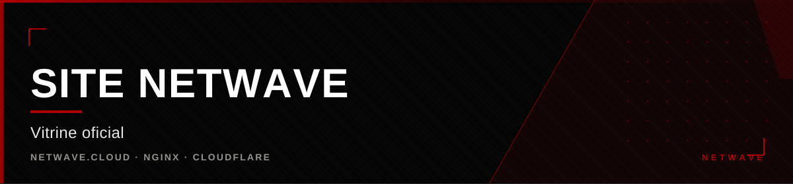

<div align="center">



</div>

<div align="center">

[](https://github.com/hiro0010/netwave-site) [](https://github.com/hiro0010/netwave-site) [](https://github.com/hiro0010/netwave-site) [](https://github.com/hiro0010/netwave-site)

</div>


## O que é

O site público da Netwave: vitrine dos projetos, loja com planos, página de
status do servidor Minecraft, área de conta e identidade visual. É onde a
Netwave se apresenta para fora — e onde o Netwave ID vira login real.

**Em produção** desde setembro de 2026, em `netwave.cloud`, atrás de nginx e
Cloudflare.

---

## Stack

| Camada | Tecnologia |
|---|---|
| Frontend | HTML, CSS e JavaScript puros — sem framework |
| Build | Node.js puro, sem dependências |
| Servidor | nginx + Cloudflare |
| Backend | Docker · Node · MariaDB |
| Autenticação | Netwave ID — sessão por token, Google OAuth, código por e-mail |

Zero dependências no frontend significa que o site é hospedável em qualquer
lugar estático, sem build pipeline e sem lockfile.

---

## Design system

Quatro camadas CSS, na ordem:

1. `variables.css` — tokens
2. `base.css` — reset, headings, grid de 12 colunas
3. `components.css` — header, botões, cards, badges, formulários, footer
4. `pages.css` — hero, split-panel, produto, pricing, auth

O grid de 12 colunas precisa colapsar para `1fr` no mobile — trocar apenas
para `span 12` não basta, porque as colunas vazias continuam ocupando espaço e
criam scroll horizontal.

---

## Netwave ID

A autenticação é real, não mockup. `API_URL` fica **vazio de propósito** para
o nginx fazer o proxy same-origin de `/api/` para o backend.

Endpoints: `register`, `login`, `logout`, `me`, `change-password`,
`email-code/start`, `email-code/verify` e `oauth/start` (Google).

O código de recuperação é de **6 caracteres alfanuméricos** (sem I/O), com TTL
de 8 minutos e 5 tentativas.

**A pegadinha:** o backend consome o código e aceita a nova senha **na mesma
chamada**. O frontend precisa fazer uma única chamada com código e senha
juntos — validar o código e depois a senha em chamadas separadas sempre falha
com `CODE_INVALID`.

---

## Rotas

Cada rota é um **diretório com `index.html`**, nunca um `.html` solto. Com
arquivos soltos, o diretório `produtos/` colide com `produtos.html` no
`try_files` e a rota quebra.

```
try_files $uri/index.html $uri.html $uri $uri/ =404;
```

A ordem de `$uri/index.html` **antes** de `$uri` é o que elimina o 301 de
diretório em toda navegação interna.

São 18 rotas: `/`, `/produtos` (com páginas de Axiom, NYX, Mochi-AC e
AxionEngine), `/infraestrutura` (com Vitalis), `/store`, `/status`, `/sobre`,
`/suporte`, `/entrar`, `/conta` e as páginas legais.

---

## Store

Produtos com **modalidades de acesso** — semanal, mensal, anual ou permanente.
O card mostra um preço resumido e um dropdown custom troca a modalidade na
hora, sem `<select>` nativo.

O checkout propaga a modalidade e grava **entitlements** (permissões) com
expiração quando aplicável. Quem compra vê as chaves na área de conta.

> O checkout ainda não é integrado a um processador de pagamento. A Store
> exibe o aviso explicitamente, em vez de simular uma compra concluída.

---

## Cache

Os assets são versionados **por caminho** (`assets/v8/css/...`), não por query
string. O Cloudflare ignora a query string na chave de cache: `?v=2` não
invalida nada, `/v8/` invalida.

Ordem obrigatória no deploy: bump da versão → build → sync dos assets →
publicação. Buildar antes do bump gera HTML apontando para assets inexistentes.

---

## Decisões de conteúdo

- **Posicionamento:** empresa de infraestrutura e software. Gaming é uma das
  linhas, não o centro.
- **Voz:** PT-BR.
- **Honestidade operacional:** o status mostra "não foi possível confirmar"
  quando a API falha, em vez de fingir que está tudo certo.


<div align="center">

<sub>Parte da <a href="https://github.com/hiro0010/netwave">Netwave</a>
&middot; Owner: <a href="https://github.com/hiro0010">Hiro</a></sub>

</div>
